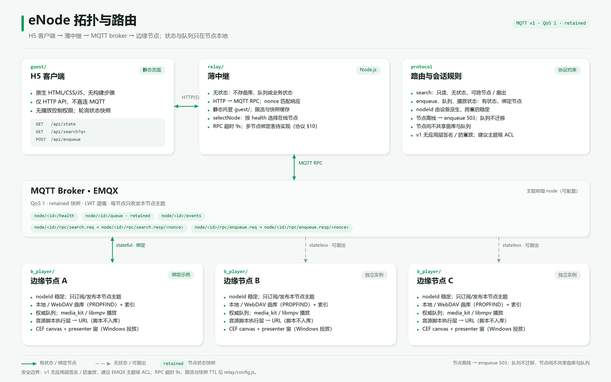

# eNode

基于 MQTT 的边缘播放节点：Flutter 节点持有曲库、权威队列与播放引擎，Node.js 中继负责 HTTP↔MQTT
转换，H5 客户端为纯静态页面。

## 架构

```
guest/ (HTML/CSS/JS) ──HTTP── relay/ (Node.js) ──MQTT── broker ──MQTT── b_player/ (Flutter) × N
                       /api/state /api/search /api/enqueue        RPC          本地/WebDAV 曲库、权威队列、播放、投放
```



- 业务状态收敛在边缘节点；relay 不存业务数据，只做限流、节点路由与 retained 快照缓存。
- `search` 为无状态查询，可跨节点扇出；`enqueue`、队列与播放状态为有状态请求，必须绑定权威节点。
- 节点通过 MQTT 发布 `health` 心跳与 retained 状态快照；正常退出补发离线，异常断链由遗嘱兜底。

## 目录

| 目录 | 职责 | 技术栈 |
|---|---|---|
| [`b_player/`](b_player) | 边缘节点 App（Windows / Android / iOS）：本地目录与 WebDAV 曲库扫描、在线音源脚本执行层、MQTT 节点、权威队列、libmpv 播放、CEF 多屏投放 | Flutter 3.44 / Dart，`media_kit`、`mqtt_client`、`flutter_js` |
| [`relay/`](relay) | HTTP → MQTT RPC 转换，静态托管 H5；限流、快照缓存、节点路由 | Node 18+，唯一依赖 `mqtt` |
| [`guest/`](guest) | 静态 H5 客户端，无构建步骤；调用 `/api/state`、`/api/search`、`/api/enqueue` | 原生 HTML/CSS/JS |
| [`docs/`](docs) | 边缘节点对接协议 v1（MQTT） | — |

## 协议要点

改代码前先读 [`docs/edge-integration-protocol.md`](docs/edge-integration-protocol.md)。

- 请求分两类：`search` 只读、无状态，可跨节点；`enqueue` 与队列/播放状态有状态，必须绑定目标节点。
- 对外只暴露 `search` / `enqueue`；播放控制不开放给中继与 H5。
- `nodeId` 由设备派生，跨重启稳定，绑定关系按它写入。
- 状态读取走 retained 快照，客户端不追实时；`health` 10s 心跳。

## 构建与运行

### 边缘节点

```bash
cd b_player
flutter pub get
flutter run -d windows          # 或 -d <android device id>
flutter test                    # 协议、曲库扫描、播放引擎、UI
ONLINE_LIVE=1 flutter test test/lx_live_test.dart   # 可选：真实网络自检（默认跳过）
```

出包：

```powershell
# Windows：便携 zip；加 -Installer 同时出安装包（需 VS C++ 工具链与 Inno Setup）
powershell -ExecutionPolicy Bypass -File tool\package_windows.ps1 -Installer
#   -> dist\eNode-<ver>-win-x64.zip / eNode-<ver>-win-x64-setup.exe
flutter build apk --release     # -> build/app/outputs/flutter-apk/app-release.apk
```

曲库索引持久化在应用支持目录；来源为本地目录与 WebDAV。WebDAV 通过递归 PROPFIND 扫描，
跳过 `@eaDir`、回收站与点目录；凭据保存在本机 SharedPreferences，不拼 URL、不写日志。

### 中继

```bash
cd relay
npm install
MQTT_HOST=broker.example.com MQTT_PORT=1883 \
MQTT_USERNAME=<账号> MQTT_PASSWORD='<密码>' \
npm start                       # 默认 0.0.0.0:8080，PORT 可改；同时静态托管 ../guest
```

TLS 连接设 `MQTT_TLS=1`。接口：`GET /api/state`、`GET /api/search?q=`、`POST /api/enqueue`。

### Windows 实现细节

- 关闭主窗口只收进托盘，进程与 MQTT 连接继续运行；托盘左键唤回窗口，右键菜单为打开 / 开机启动 / 退出。
- 开机启动写 `HKCU\Software\Microsoft\Windows\CurrentVersion\Run`（值名 `eNode`）；单实例用 `127.0.0.1:47621` 占位。
- 版本号唯一来源是 `pubspec.yaml` 的 `version`：构建时写入 exe 属性，运行时由 `package_info_plus` 读回。
- 屏幕投放：一块 CEF canvas 承载全部屏幕构图，每个目标屏一个置顶、鼠标穿透的 presenter 窗；
  时间锚点只有一份，各窗按本地墙钟推进，主进程每秒纠偏。建窗串行，CEF 不可用时退回一屏一引擎，再退 Flutter 自绘。

## 部署参数

仓库不内置 broker 凭据。

- **边缘节点**：设置页写入本机配置，支持 MQTT URL 或 `Broker / 端口 / 账号 / 密码` 多行格式；
  未配置时不连接 broker。日志与提交信息不得打印凭据值。
- **中继**：环境变量 `MQTT_HOST`（必填，缺失拒绝启动）、`MQTT_PORT`（默认 1883）、
  `MQTT_USERNAME`、`MQTT_PASSWORD`、`MQTT_TLS`（`1` 开启）、`MQTT_TOPIC_PREFIX`（默认 `node`，
  需与节点一致）。限流、RPC 超时、快照 TTL 见 [`relay/config.js`](relay/config.js)。
- **在线音源**：地址与密钥在运行时导入，落节点本地存储，不入库、不打日志。

## 已知边界

- 多节点路由未落地：`relay` 当前选择 `health` 最新的在线节点（`selectNode`），等价于一中继一节点；
  协议 §10 已定义节点绑定表与 `NODE_NOT_BOUND` 处置。
- v1 无应用层签名与防重放，只有 broker 连接与主题权限；建议用 EMQX 主题级 ACL 约束。
- 队列不跨节点迁移：节点离线期间 `enqueue` 返回不可用，不做补发。
- 播放依赖在线音源解析；源变更表现为跳过，坏文件自动跳过并降级。

## 品牌与图标

[`b_player/brand/make_icons.py`](b_player/brand/make_icons.py) 从同一份矢量绘制生成 Android/iOS/Windows/Web
图标与 `enode-logo-1024.png`。Windows 托盘使用同源 16px 的 `b_player/assets/icons/enode.ico`。
全平台显示名 **eNode**；Android 包名 `com.enode.b_player`，iOS Bundle ID `com.enode.bPlayer`。

## 第三方与许可

- 架构参考 any-listen（AGPL-3.0）的分层与启动流程，未复制其代码。
- 随包分发的 CEF、libmpv/FFmpeg、Flutter、flutter_chromium_webview 与 relay 的 `mqtt` 依赖，
  许可与来源见 [THIRD_PARTY_NOTICES.md](THIRD_PARTY_NOTICES.md)。
- 本项目以 [AGPL-3.0](LICENSE) 发布，Copyright (C) 2026 eNode contributors。分发修改版或以网络服务
  形式提供时，须按 AGPL-3.0 开放对应源码。
- 仓库不包含媒体文件、音源脚本或内容源。
